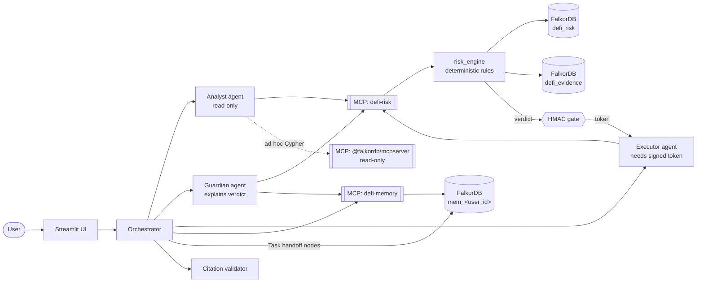
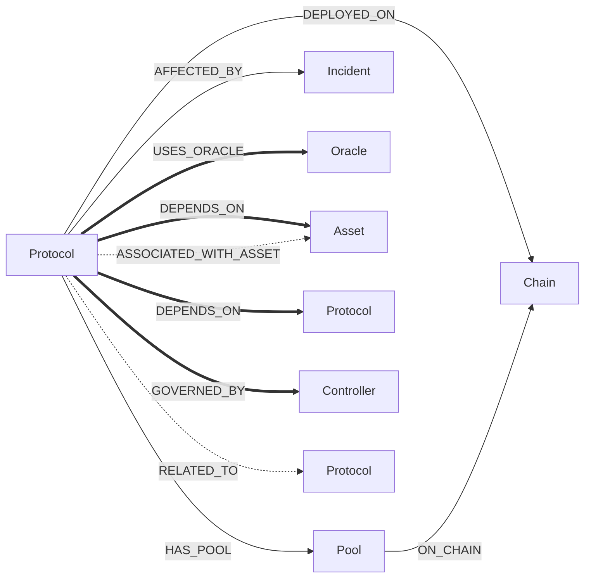
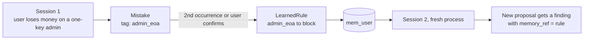

# Bulwark

**A DeFi risk guardian whose agents reason over a FalkorDB graph, remember each user across sessions, and cannot act without a signed approval.**


## The problem

DeFi risk is rarely in the protocol you are looking at. It sits two or three hops away: a shared oracle, a stablecoin with a weak peg, a single-key admin, a dependency that was hacked last year. An LLM with a search box sees one hop. A dashboard shows one protocol at a time. Two "diversified" positions can quietly rest on the same oracle, and nothing warns you until it fails.

Agents that move money have a second problem: they forget. The same user makes the same mistake in the next session, and a model that "decides" the risk can be talked into anything.

## What Bulwark does

You propose a position ("put $2,000 into X"). Bulwark:

1. **Walks the dependency graph** up to 3 hops over *verified* edges only, finding shared oracles, stablecoin pegs, admin keys and incidents the protocol itself never mentions.
2. **Applies deterministic rules** to what it found. The LLM never decides the verdict; it explains it, with the graph path and source URL behind every finding.
3. **Remembers you.** Mistakes, preferences and learned rules live in a per-user memory graph. Next session, a rule you earned last week caps or blocks a new proposal.
4. **Gates the action.** The executor agent can only act with an HMAC-signed token issued for that exact proposal and amount.
5. **Says "not in the graph"** when it does not know. An empty traversal means *not modelled*, never *safe*.

## Why it needs a graph

| Question | Without a graph | With the FalkorDB graph |
|---|---|---|
| "Is X risky?" | Summarises X's own docs (hop 1) | Finds the oracle X shares with two other holdings (hop 2-3) |
| "Am I diversified?" | Counts tickers | Computes capital share per shared dependency |
| "What breaks if oracle O fails?" | Guesses | Reverse traversal with per-edge strength, estimated loss per position |
| "Have I made this mistake before?" | No memory | Tag join to the user's memory graph, rule fires |

See [Graph-off comparison](#graph-off-comparison) for the same prompts run with graph tools disabled.

---

## Architecture



One FalkorDB instance, three kinds of graph:

| Graph | Contents | Writer |
|---|---|---|
| `defi_risk` | Shared protocols, chains, assets, pools, oracles, controllers, incidents and dependency edges | Ingestion scripts only. Agents never write here |
| `defi_evidence` | Documentation and source records, joined to risk entities by slug in application code | Seed script |
| `mem_<user_id>` | One isolated graph per user: preferences, episodes, mistakes, learned rules, sessions, agent tasks | Memory subsystem |

FalkorDB has no cross-graph Cypher, so the joins are explicit: evidence by slug, memory by a **controlled tag vocabulary** (`young_protocol`, `admin_eoa`, `shared_dependency`, ...) that both the risk findings and the memory records use.

---

## Graph data model



**Thick arrows carry risk. Dashed arrows never do.** A thick edge only propagates risk if it is explicitly `risk_eligible = true`, carries a verified status, is not a test edge, and has a `source_url`. Anything else stays in the graph for context but is invisible to every risk query. `RELATED_TO` (from DeFiLlama `otherProtocols`) and `ASSOCIATED_WITH_ASSET` are associations, not dependencies, and are excluded by type regardless of their properties.

### What is in the graph

| Entity | Count | Source |
|---|---|---|
| `Protocol` | **27** | Selected DeFi subset of DeFiLlama `/protocols` (8,749 records) and `/protocol/{slug}` |
| `Pool` | **54** | DeFiLlama yields `/pools` (16,563 records), with `apy`, `apy_base`, `apy_reward`, `il_risk`, `outlier` |
| `Asset` (stablecoins) | **11** | DeFiLlama `stablecoins.llama.fi`, with `peg_mechanism`, `peg_type`, price |
| `Chain` | **8** | DeFiLlama `/v2/chains` (425 records) |
| `Incident` | **2** | Structured `hacks` records from `/protocol/{slug}` |
| `Oracle` | **3** | Curated seed with official documentation URLs |
| `Controller` | **2** | Curated seed (`aave-governance`, `chainlink-node-operators`) |
| `Evidence` (in `defi_evidence`) | curated | Documentation records for the curated edges |
| Relationships | `DEPLOYED_ON`, `HAS_POOL`, `ON_CHAIN`, `AFFECTED_BY`, `RELATED_TO`, `USES_ORACLE`, `DEPENDS_ON`, `GOVERNED_BY`, `ASSOCIATED_WITH_ASSET` | Derived during ingestion or curated |

**The graph is small on purpose.** A graph full of guessed dependencies is worse than useless for a risk tool. Every risk-carrying edge is hand-curated from official documentation and keeps its `source_url`; the 27/54/11 DeFiLlama-derived nodes give those edges realistic context. Coverage is the limitation, and the engine reports it instead of hiding it (see [Honest limits](#honest-limits)).

### Provenance

| Data | Where it comes from |
|---|---|
| Protocol, chain, asset, pool, incident attributes | Public DeFiLlama APIs. Raw snapshots saved under `data/raw/` |
| `DEPLOYED_ON`, `HAS_POOL`, `ON_CHAIN`, `AFFECTED_BY` | Derived from the same responses during ingestion |
| `RELATED_TO` | DeFiLlama `otherProtocols`. Association only |
| `Oracle`, `USES_ORACLE`, curated `DEPENDS_ON` / `GOVERNED_BY`, `defi_evidence` | **Seeded** by `scripts/seed_curated_relationships.py` from official docs. Each edge keeps `source_url`, `verification_status`, `risk_eligible`, `strength` |
| `mem_<user_id>` | Not seeded. Created by the memory subsystem as the user interacts |

Reproduce from scratch:

```bash
docker compose up -d
python -m scripts.init_graphs
python -m scripts.ingest_defillama
python -m scripts.seed_curated_relationships
python -m scripts.check_ingestion
```

---

## How the agent reasons over the graph

All Cypher lives in [`risk_engine/queries.py`](risk_engine/queries.py); `python -m risk_engine.cli queries` prints every query. The eligibility predicate (`ELIG`) is applied to **every edge of every path**, in Cypher:

```cypher
// ELIG(e): fail-closed. Missing flags exclude the edge.
coalesce(e.risk_eligible,false) = true
AND toLower(coalesce(e.verification_status,'')) IN ['verified', ...]
AND coalesce(e.is_test,false) = false
```

**1. Multi-hop dependencies of a protocol** (what is X really built on?)
```cypher
MATCH path = (p:Protocol)-[:DEPENDS_ON|USES_ORACLE|GOVERNED_BY*1..3]->(o)
WHERE p.slug IN $keys AND ALL(e IN relationships(path) WHERE ELIG(e))
RETURN p.slug, labels(o), properties(o),
       [n IN nodes(path) | coalesce(n.slug, n.oracle_id, n.asset_id, n.controller_id)],
       [e IN relationships(path) | type(e)],
       [e IN relationships(path) | e.strength],
       [e IN relationships(path) | e.source_url]
```

**2. Shock simulation** (who breaks if node `$k` fails? Walk incoming edges)
```cypher
MATCH path = (o)-[:DEPENDS_ON|USES_ORACLE|GOVERNED_BY*1..3]->(s)
WHERE coalesce(s.slug, s.oracle_id, s.asset_id, s.controller_id) = $k
  AND ALL(e IN relationships(path) WHERE ELIG(e))
RETURN ... // same path columns as above
```

**3. Incidents for a set of dependencies**
```cypher
MATCH (p)-[:AFFECTED_BY]->(i:Incident)
WHERE coalesce(p.slug, p.oracle_id, p.asset_id) IN $keys
RETURN coalesce(p.slug, p.oracle_id, p.asset_id), properties(i)
```

**4. Pools for yield-quality checks**
```cypher
MATCH (p:Protocol)-[:HAS_POOL]->(pl:Pool) WHERE p.slug = $k RETURN properties(pl) LIMIT 50
```

**5. Graph-health diagnostics** (why is my output empty?)
```cypher
MATCH ()-[e:DEPENDS_ON|USES_ORACLE|GOVERNED_BY|RELATED_TO|ASSOCIATED_WITH_ASSET]->()
RETURN type(e), count(e),
       sum(CASE WHEN ELIG(e) THEN 1 ELSE 0 END) AS eligible
```

**6. Per-user memory context** (Track 2). Mistakes and rules are matched to risk findings by tag:
```cypher
MATCH (u:User {id:$uid})-[:LEARNED]->(r:LearnedRule)
RETURN r.id, r.tag, r.action, r.cap_pct, r.note
```

### Algorithms

| Algorithm | Where | What it does |
|---|---|---|
| Bounded variable-length traversal (depth clamped to 1-4, default 3) | `queries.py` | Finds dependency paths; depth is a validated integer, never user text |
| Per-edge eligibility filter | `queries.py` | `ALL(e IN relationships(path) WHERE ELIG(e))` so an ineligible edge can never reach a rule |
| Shock propagation | `propagation.py` | Impact = severity x product of edge `strength` along the best path (fewest hops, then strongest). An **estimate**, labelled as one |
| Shared-dependency exposure | `propagation.py` | Groups holdings by common dependency and computes capital share, before vs after the proposed position |
| PageRank (systemic importance) | `propagation.py` | Computed in Python over eligible edges only. FalkorDB's native `algo.pageRank` filters by label and type, not edge property, so it would count ineligible edges |
| Rule engine R1-R9, S1 | `rules.py` | Deterministic checks (table below) producing findings with path, severity, action and cap |
| HMAC action gate | `gate.py` | Issues a time-limited token bound to protocol, chain and approved amount. The executor verifies it |
| Citation validator | `agents/` | Every protocol id, USD amount, percentage and URL in the final answer must appear in this turn's tool results |
| Tag join | `memory/` | Links risk findings to a user's mistakes and learned rules without cross-graph queries |

### Risk rules

| Rule | Fires on | Action |
|---|---|---|
| R1 | One shared dependency would hold >40% of capital | cap |
| R2 | No listed audits / listed under 90 days | cap 5% |
| R3 | Own or dependency incident in the last 2 years | cap 10% / 5% |
| R4 | Dependency stablecoin >1% off peg, or algorithmic | block / cap |
| R5 | Single-key or <3-signer controller, no timelock, single oracle | cap / warn |
| R6 | TVL collapse, APY outliers, reward-driven yield | warn |
| R7 | User's learned rules and past mistakes (memory) | per rule |
| R8 | User preferences (max position, avoid category/chain) | cap / block |
| R9 | No verified dependencies modelled | warn: unknown, not safe |
| S1 | Synthetic what-if shock, computed in memory, never written | warn / cap |

Thresholds are **illustrative policy** in `risk_engine/config.py`, not industry standards. A user's `risk_tolerance` scales percentage caps (0.5x / 1x / 1.5x).

---

## Agents, tools and MCP

| Agent | Allowed tools | Role |
|---|---|---|
| Analyst | `search_protocol`, `get_protocol_profile`, `simulate_shock`, `portfolio_exposure`, `systemic_importance`, read-only Cypher | Gather context |
| Guardian | `assess_proposal`, memory tools | Run the engine, explain the verdict with citations |
| Executor | `execute_paper_trade` | Acts **only** with a valid gate token |

- **`defi-risk` MCP server** wraps the risk engine. `gate.issue` is *not* exposed to any model; the orchestrator issues tokens, and only for `ALLOW`, `WARN` or `ALLOW_WITH_CAP` verdicts.
- **`defi-memory` MCP server** exposes load/record/promote/forget for the user's memory graph.
- **Official `@falkordb/mcpserver`** (read-only) is available for ad-hoc Cypher.
- **Coordination:** agents hand work to each other through `Task` nodes in the user's graph (`from`, `to`, `status`, `payload_ref`), so state lives in the graph and not in chat history.

## Memory across sessions



Node types: `User`, `Preference`, `Session`, `Episode` (proposal, verdict, decision, outcome), `Mistake`, `LearnedRule`, `Task`. Writes are idempotent (`MERGE`) and parameterised. A test starts a fresh set of objects for "session 2" and proves a rule recorded in session 1 changes the verdict.

---

## Graph-off comparison

Same prompts, same model, graph tools disabled (`--graph-off`):

| Prompt | Graph on | Graph off |
|---|---|---|
| `<prompt 1: shared-oracle portfolio>` | `<fill from run>` | `<fill from run>` |
| `<prompt 2: hop-3 dependency incident>` | `<fill from run>` | `<fill from run>` |
| `<prompt 3: unknown protocol>` | Blocks, "not in the graph", did-you-mean | `<fill from run>` |

## Why FalkorDB

For 27 protocols, any database can store the data. We chose FalkorDB for what the *workload* needs. We did not run a benchmark, and the comparison below is about fit, not speed.

| Need | FalkorDB | Neo4j | RDBMS (Postgres) |
|---|---|---|---|
| Bounded multi-hop traversal with a predicate on **every edge** | Native Cypher: `ALL(e IN relationships(path) WHERE ...)` | Same | Recursive CTE; per-edge predicates and path arrays are verbose and easy to get wrong |
| One isolated graph **per user** | Many graphs per instance, selected by name. `mem_<user_id>` is a one-line `select_graph` | Multiple databases need Enterprise Edition; Community has one user database | Schema or tenant column per user, or a table per graph |
| Agent tooling | Official MCP server; Python client; GraphRAG-SDK for the evidence layer | Mature ecosystem and MCP options | Generic SQL MCP servers; no graph semantics |
| Tests without Docker | **FalkorDBLite** embeds the engine, so our 30 tests run in under a second | Needs a server | Needs a server (or SQLite with different semantics) |
| Operational footprint | Redis-protocol server, one container | JVM server | Server |
| Maturity and tooling | Younger | Most mature, richest tooling | Most mature overall |

Where it wasn't a fit, we say so. FalkorDB's Cypher is a subset: we hit two gaps while building and documented both in `queries.py`:
- **No parameters in variable-length bounds** (`*1..$d` fails). Depth is a validated integer formatted into the query text.
- **No `EXISTS { MATCH ... }` subqueries.** "Does this holding share a dependency?" is computed in Python over returned paths.

## Quick start

```bash
git clone <repo> && cd graphino
python -m venv .venv && source .venv/bin/activate        # Windows: .\.venv\Scripts\Activate.ps1
pip install -r requirements.txt
cp .env.example .env                                     # set FALKORDB_HOST/PORT, LLM key, BULWARK_GATE_SECRET
docker compose up -d                                     # FalkorDB + Browser on :3000

python -m scripts.init_graphs
python -m scripts.ingest_defillama
python -m scripts.seed_curated_relationships
python -m scripts.check_ingestion

python -m risk_engine.cli diagnose                       # confirms eligible dependency edges exist
pytest tests -q                                          # unit test suite
streamlit run app/main.py
```

CLI examples:
```bash
python -m risk_engine.cli shock chainlink-node-operators --severity 0.8 --hops 3
python -m risk_engine.cli exposure aave-v3:1000 sparklend:1000
python -m risk_engine.cli assess aave-v3 1000 --hold sparklend:500 --tolerance conservative
```

## Demo script (5 beats)

1. **Depth 1 vs depth 3.** A protocol that looks fine alone fails at hop 3 through a shared oracle or stablecoin.
2. **Hidden concentration.** Two "diversified" holdings share one dependency; Bulwark caps the new position.
3. **Memory.** Record a mistake in session 1, restart, and session 2 applies the learned rule with a `memory_ref`.
4. **Abstention.** An unmodelled protocol gets "not in the graph", not a guess.
5. **The gate.** The executor refuses without a valid token, and refuses a token issued for a different amount.

## Honest limits

- **Small, curated dependency coverage.** 27 protocols and 8 dependency-capable edges seeded (4 verified eligible: Aave V3 and SparkLend to Chainlink feeds, feeds to node operators, Aave V3 to governance). The engine reports `coverage.data_gaps` and returns `R9` ("unknown, not safe") when no verified dependency is modelled for a protocol.
- **`ALLOW` means no rule fired on modelled data. It never means safe.**
- **Impact numbers are estimates** from curated edge strengths. Thresholds are illustrative policy.
- **Audit counts** come from DeFiLlama listings; absence of a listed audit is not proof there was none.
- **No real funds, keys or transactions.** Paper trading only. Not financial advice.
- Protocol, chain, stablecoin, pool and incident data are from public DeFiLlama APIs, used for research and demonstration.

## Repository layout

```
scripts/          ingestion + curated seed (init_graphs, ingest_defillama, seed_curated_relationships, check_ingestion)
risk_engine/      deterministic engine: queries, propagation, rules, evidence, gate, CLI
mcp_servers/      defi-risk and defi-memory MCP servers
memory/           per-user memory graph
agents/           orchestrator, Analyst / Guardian / Executor, citation validator
app/              Streamlit UI
tests/            engine + memory + agent tests (FalkorDBLite fixture graph)
docs/             RISK_ENGINE.md, DEMO_SCRIPT.md
```

## Data attribution

DeFiLlama public APIs (`api.llama.fi`, `stablecoins.llama.fi`, `yields.llama.fi`). Curated relationships keep their official documentation URLs. FalkorDB and GraphRAG-SDK by FalkorDB.