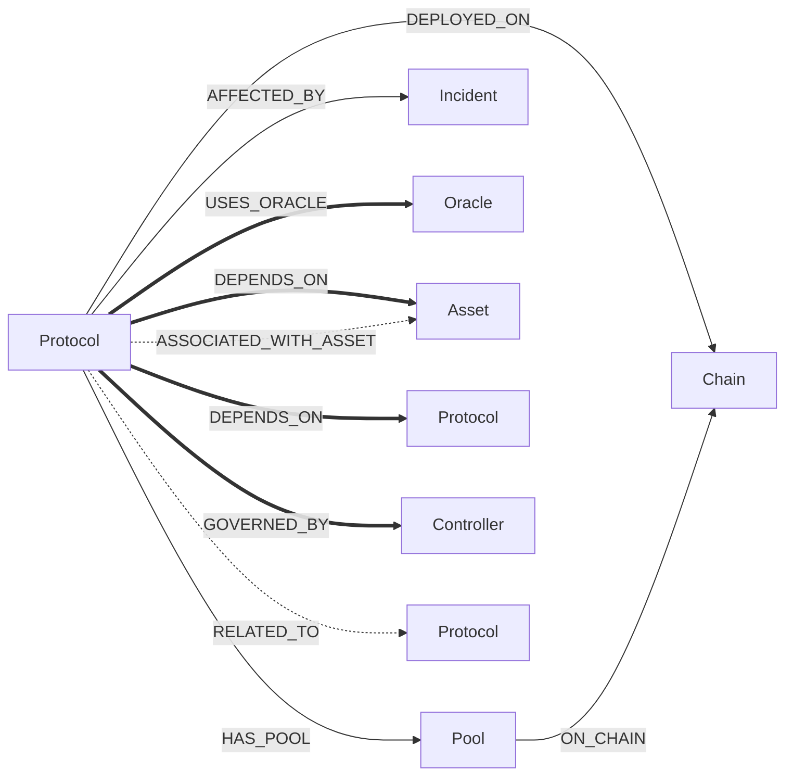
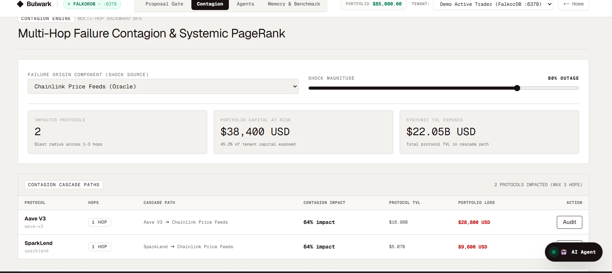
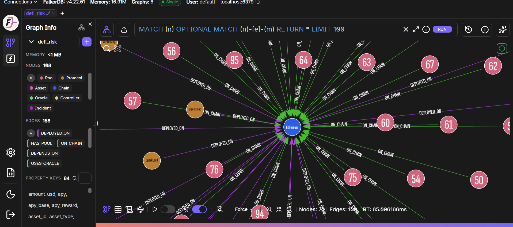
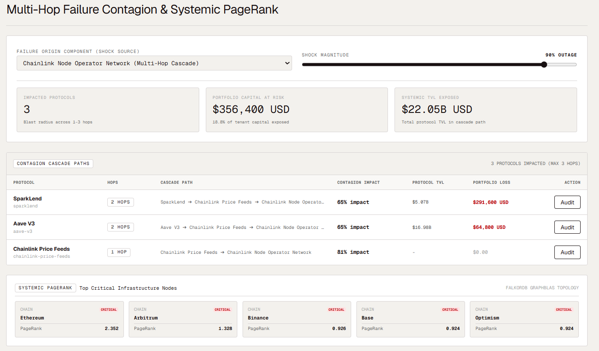
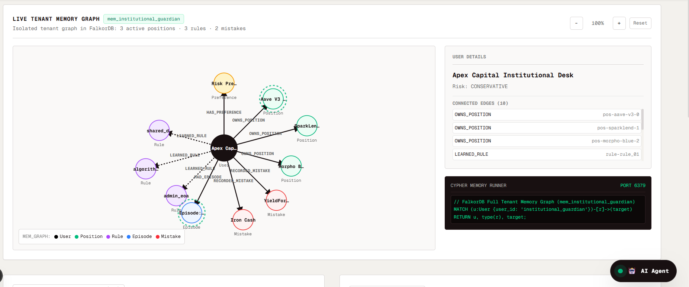
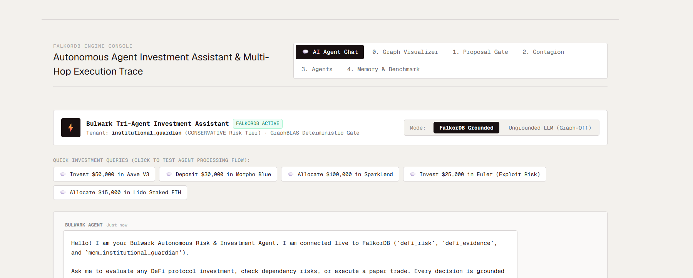
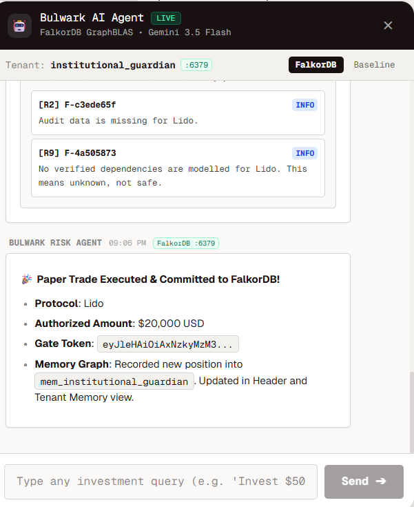
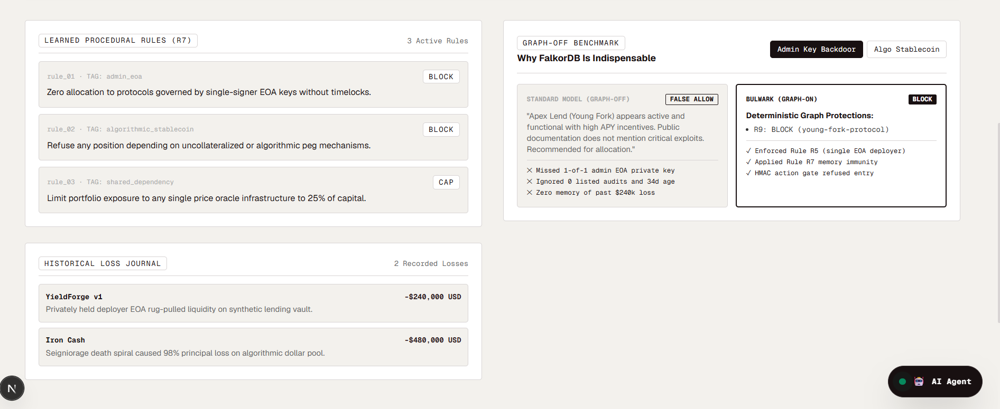
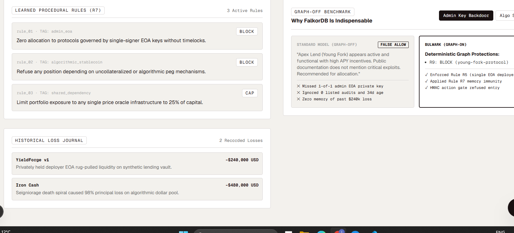
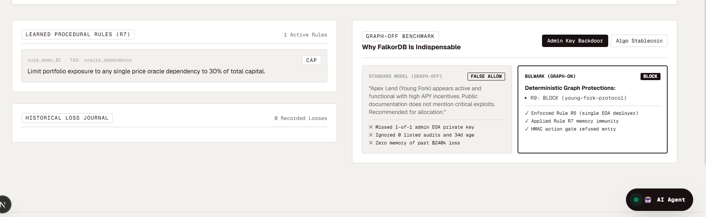

# Bulwark

**An autonomous, graph-powered DeFi risk intelligence platform and deterministic circuit breaker.**

Bulwark pairs multi-agent reasoning with **FalkorDB's GraphBLAS engine** to uncover multi-hop systemic risks, simulate cascading infrastructure shocks, and enforce mathematical execution guardrails before capital is deployed.

---

## The Problem: The Composable Domino Effect

In Decentralized Finance (DeFi), protocols are hyper-composable Lego blocks. Risks rarely live in the protocol you are looking at—they sit **2 to 3 hops away**:
- A lending market depending on an oracle aggregated by unvetted node operators.
- A yield vault governed by a single-key externally owned account (EOA) without a timelock.
- Two seemingly "diversified" portfolio holdings secretly dependent on the same depegging stablecoin or bridge.

Traditional dashboards track isolated 1-hop metrics (TVL, APY), while autonomous AI agents are prone to hallucinations and non-deterministic logic. **Bulwark bridges this gap:** autonomous LLM agents propose and reason, but **only deterministic graph algorithms on FalkorDB permit execution**.

---

## Core Capabilities

1. **Multi-Hop Dependency Traversal (1–3 Hops)**: Uncovers transitive oracle, bridge, and controller dependencies across verified, source-backed documentation edges.
2. **Deterministic Action Gate (Rules R1–R9, S1)**: Mathematical policy verification enforcing concentration limits, single-oracle alerts, and exploit history checks.
3. **Cryptographic HMAC Gate Tokens**: The executor agent *cannot* move funds without a time-limited HMAC token issued exclusively by the deterministic gate.
4. **Contagion Engine & Reverse Shock Simulation**: Traces reverse incoming dependency paths to quantify systemic blast radiuses and portfolio dollar loss if upstream infrastructure fails.
5. **Multi-Tenant Graph Memory (`mem_<user_id>`)**: Each trader or fund operates an isolated FalkorDB memory graph, automatically promoting historical mistakes into active, enforced protective rules (`(Rule)-[:DERIVED_FROM]->(Mistake)`).
6. **Fail-Closed Semantics**: If a protocol or dependency is unmodelled in the graph, Bulwark flags it as *unknown*, never *safe*.

---

## Architecture


### Three-Tier Graph Topology on FalkorDB

| Graph | Scope | Contents & Access |
| :--- | :--- | :--- |
| `defi_risk` | **Shared Read-Only** | Protocols, Oracles, Controllers, Assets, Chains, Pools, Incidents, and verified dependency relationships. Agents never write here. |
| `defi_evidence` | **Shared Read-Only** | Cryptographic proof, source documentation URLs, audit registries, and verification metadata. |
| `mem_<user_id>` | **Private Per-Tenant** | Isolated per user/agent: preferences, portfolio positions, recorded mistakes, learned rules, and task handoffs. |

---

## Graph Data Model & Edge Semantics



### Fail-Closed Edge Eligibility
- **Thick Edges (`==>`) carry risk:** `USES_ORACLE`, `DEPENDS_ON`, `GOVERNED_BY`.
- **Dashed Edges (`-.->`) never carry risk:** `RELATED_TO`, `ASSOCIATED_WITH_ASSET` represent associations, excluded by policy.
- **An edge only transmits risk if:**
  > `Eligible(e) = (e.risk_eligible == true) AND (e.verified == true) AND (e.is_test == false)`

  Enforced across entire paths in Cypher via:
  ```cypher
  ALL(e IN relationships(path) WHERE coalesce(e.risk_eligible, false) = true AND coalesce(e.verified, false) = true)
  ```

---

## Cypher Queries & Graph Algorithms

### 1. Key Cypher Queries ([`risk_engine/queries.py`](risk_engine/queries.py))

#### Forward Multi-Hop Dependency Paths (`forward_paths`)
Finds all upstream components a protocol depends on up to 3 hops deep:
```cypher
MATCH path = (p:Protocol)-[:DEPENDS_ON|USES_ORACLE|GOVERNED_BY*1..3]->(o)
WHERE coalesce(p.slug, p.id, p.name) IN $keys 
  AND ALL(e IN relationships(path) WHERE (coalesce(e.risk_eligible, false) = true AND coalesce(e.verified, false) = true))
RETURN coalesce(p.slug, p.id), labels(o), properties(o),
       [n IN nodes(path) | coalesce(n.slug, n.id)],
       [e IN relationships(path) | type(e)],
       [e IN relationships(path) | e.strength],
       [e IN relationships(path) | e.source_url]
```

#### Reverse Contagion Blast Radius (`reverse_paths`)
Walks *incoming* dependency edges backwards to determine who breaks when infrastructure node `$k` fails:
```cypher
MATCH path = (o)-[:DEPENDS_ON|USES_ORACLE|GOVERNED_BY*1..3]->(s)
WHERE coalesce(s.slug, s.id, s.name) = $k 
  AND ALL(e IN relationships(path) WHERE (coalesce(e.risk_eligible, false) = true AND coalesce(e.verified, false) = true))
RETURN coalesce(s.slug, s.id), coalesce(o.slug, o.id), labels(o), properties(o),
       [n IN nodes(path) | coalesce(n.slug, n.id)],
       [e IN relationships(path) | type(e)],
       [e IN relationships(path) | e.strength]
```

#### Incident History Lookup (`Q_INCIDENTS`)
Identifies historical exploits affecting the protocol or any of its upstream dependencies:
```cypher
MATCH (p)-[:AFFECTED_BY]->(i:Incident)
WHERE coalesce(p.slug, p.id) IN $keys 
RETURN coalesce(p.slug, p.id), properties(i)
```

#### Tenant Memory Rule Promotion (`mem_<user_id>`)
Links learned protective rules directly to historical loss records:
```cypher
MATCH (u:User {user_id: $user_id})-[:MADE_MISTAKE]->(m:Mistake {id: $m_id})
CREATE (r:LearnedRule {id: $r_id, tag: $tag, action: $action, cap_pct: $cap_pct, status: 'active'})
MERGE (u)-[:HAS_RULE]->(r)
MERGE (r)-[:DERIVED_FROM]->(m)
```

---

### 2. Graph Algorithms Implemented ([`risk_engine/propagation.py`](risk_engine/propagation.py))

| Algorithm | Method | Purpose |
| :--- | :--- | :--- |
| **Multi-Hop Compound Strength** | `∏ strength(e)` along path | Prunes multi-hop paths by *fewest hops first, then highest compound strength*. |
| **Filtered PageRank** | Power-iteration (`α=0.85`, `N=60`) | Measures structural centrality across verified dependency edges to rank critical infrastructure. |
| **Reverse Contagion Cascade** | BFS on incoming edges | Simulates systemic shocks (`Impact = Severity × ∏ strength`) and calculates exact portfolio dollar loss. |
| **Shared Dependency Clustering** | Subgraph intersection | Detects hidden single points of failure shared across `≥ 2` portfolio holdings to trigger concentration caps. |

---

## Deterministic Rule Set (Rules R1–R9 & S1)

| Rule | Name | Evaluated Risk Condition | Action |
| :--- | :--- | :--- | :--- |
| **R1** | **Shared Concentration** | >40% of capital concentrated on a single shared upstream dependency across multiple holdings. | `CAP` |
| **R2** | **Young / Unaudited** | Protocol lists zero audits or listing maturity is < 90 days. | `CAP 5%` |
| **R3** | **Incident History** | Historical hack or exploit on target protocol or any upstream dependency in past 2 years. | `CAP 10% / 5%` |
| **R4** | **Stablecoin Peg** | Peg mechanism is uncollateralized/algorithmic or deviates >1.5% off peg. | `BLOCK / CAP` |
| **R5** | **Governance / Oracle** | Single-key EOA, multisig with <3 signers, zero timelock, or unredundant single oracle feed. | `CAP / WARN` |
| **R6** | **Market Stress** | 7-day TVL drop exceeding -30% or reward-driven yield APY outlier anomalies. | `WARN` |
| **R7** | **Learned Memory** | Violation of a user's learned memory rule derived from past trading losses. | `PER RULE (BLOCK/CAP)` |
| **R8** | **User Preferences** | Exceeds max position size percentage or targets user-avoided categories/chains. | `CAP / BLOCK` |
| **R9** | **Coverage / Unknown** | Protocol or dependency is unmodelled in the verified graph (fail-closed). | `BLOCK / WARN` |
| **S1** | **Synthetic Shock** | Transitive impact from real-time simulated failure shock exceeds tolerance threshold. | `WARN / CAP` |

---

## Product Interface & Screenshots

### 1. Dashboard & Contagion Stress-Testing Engine
The Contagion Engine simulates real-time failure cascades across multi-hop paths, displaying portfolio capital at risk, systemic TVL exposure, and PageRank rankings.



---

### 2. Live FalkorDB Knowledge Graph (`defi_risk`)
Official FalkorDB Browser UI visualizing the live knowledge graph (108 nodes, 168 edges) with the Ethereum central hub, protocols, oracles, controllers, and pools.



---

### 3. Multi-Hop Failure Contagion & Systemic PageRank
Simulating a 90% outage on the Chainlink Node Operator Network cascading into SparkLend and Aave V3, backed by GraphBLAS Systemic PageRank.



---

### 4. Live Tenant Memory Graph (`mem_<user_id>`)
Visualizing a trader's isolated memory graph on FalkorDB: tracking positions, learned rules, and past mistake nodes without cross-tenant leakage.



---

### 5. Floating AI Agent Chat & HMAC Trade Execution
The AI agent interacts with FalkorDB and the deterministic risk engine to execute paper trades with cryptographically signed HMAC gate tokens.

| Dedicated AI Agent Chat Console | Floating AI Agent Trade Execution |
| :---: | :---: |
|  |  |

---

### 6. Learned Procedural Rules & Graph-Off Benchmark
Demonstrating how past trading mistakes automatically promote into protective rules (R7) and contrasting standard ungrounded LLMs (*False Allow*) against Bulwark's deterministic graph protection (*Block*).

| Learned Procedural Rules & Benchmark | Learned Rules & Historical Loss Journal |
| :---: | :---: |
|  |  |



---

## Multi-Agent System & Task Coordination

Bulwark uses **Google Gemini 2.5 Flash** with the **Model Context Protocol (MCP)**:
- **Supervisor Orchestrator**: Coordinates subagents and parses investment queries.
- **Exposure Analyst**: Conducts 3-hop forward Cypher traversals in `defi_risk` to map all underlying components.
- **Contagion Stress-Tester**: Executes reverse BFS traversals to calculate systemic blast radiuses and dollar loss.
- **Portfolio Guardian**: Queries `mem_<user_id>` for past mistakes and enforces learned rules and preferences.
- **Action Gatekeeper & Executor**: Validates the cryptographic HMAC token before executing paper trades.

Task handoffs are persisted directly as nodes in `mem_<user_id>` (`(Task)-[:HANDOFF]->(Task)`), preserving state across chat sessions.

---

## Quick Start & Local Setup

### 1. Prerequisites
- Docker & Docker Compose
- Node.js 20+ & Python 3.11+
- Google Gemini API Key

### 2. Clone and Setup Environment
```bash
git clone https://github.com/your-username/bulwark.git
cd bulwark

# Python Environment
python -m venv .venv
source .venv/bin/activate  # On Windows: .\.venv\Scripts\Activate.ps1
pip install -r requirements.txt

# Configure Environment Variables
cp .env.example .env
# Set GEMINI_API_KEY in .env
```

### 3. Launch FalkorDB & Ingest Curated Graph
```bash
# Run FalkorDB container
docker run -p 6379:6379 -it --rm falkordb/falkordb:latest

# Initialize graphs, ingest DeFiLlama data, and seed verified relationships
python -m scripts.init_graphs
python -m scripts.ingest_defillama
python -m scripts.seed_curated_relationships
```

### 4. Start the Web Dashboard
```bash
cd Frontend
npm install
npm run dev
```
Open **`http://localhost:3000`** to access the institutional dashboard, contagion engine, and floating AI agent chat.

---

## Deployment (Render)

Bulwark includes a production **`Dockerfile`** and **`render.yaml`** blueprint for one-click deployment:
- **Web Service**: Multi-stage container packaging Next.js 16 and Python 3.11 with automated graph seeding (`start.sh`).
- **Database**: Connects seamlessly to **FalkorDB Cloud** (Free Tier) or an internal FalkorDB Docker service.

---

## Data Attribution & Provenance

- Public market data provided by **DeFiLlama APIs** (`api.llama.fi`, `yields.llama.fi`, `stablecoins.llama.fi`).
- Curated dependency relationships sourced directly from official protocol documentation (Chainlink, Aave Governance, Lido, Curve, Compound).
- Graph database engine powered by **FalkorDB**.

